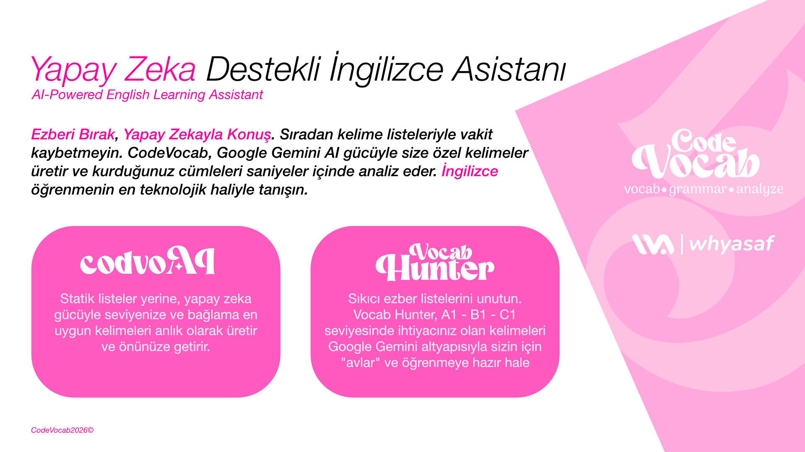
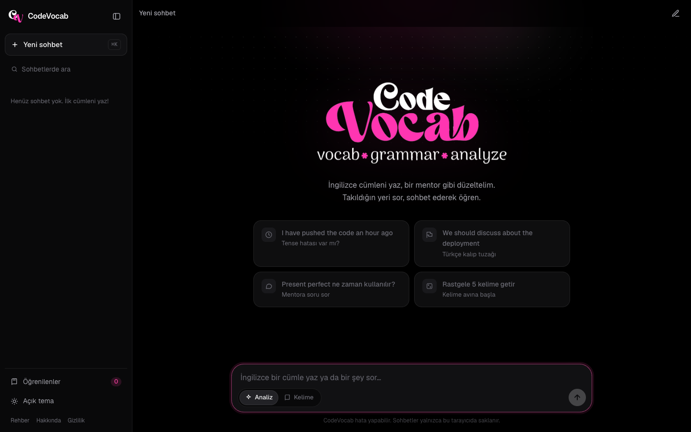
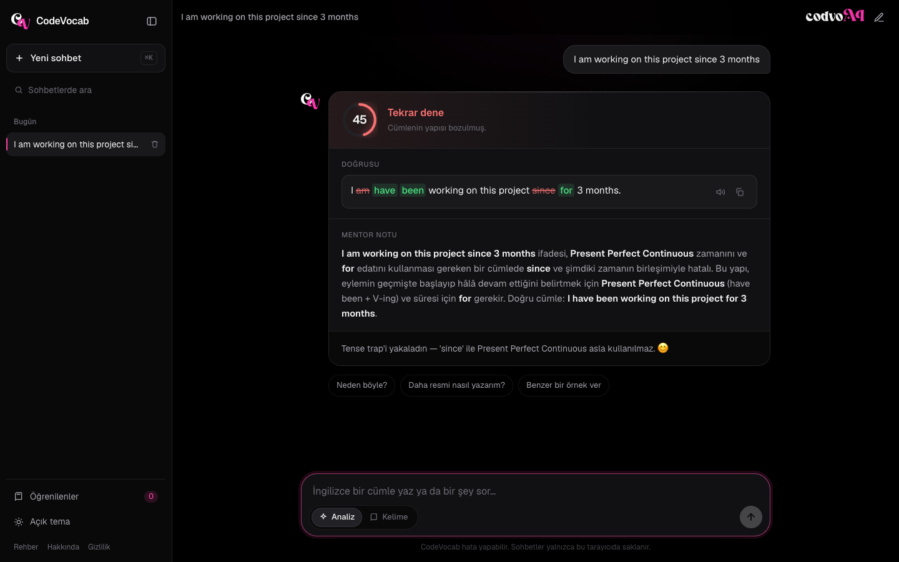
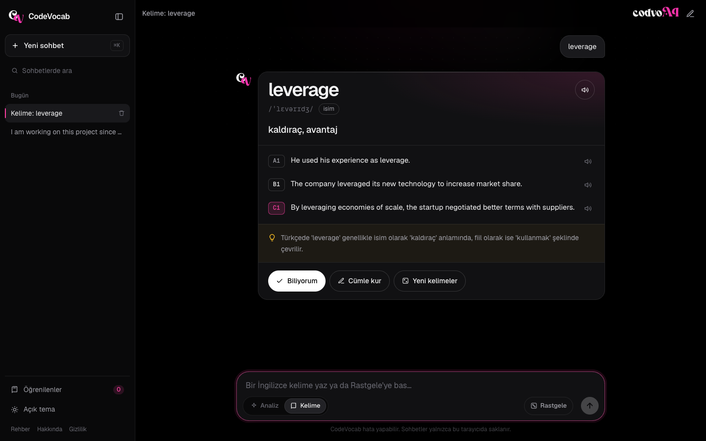

# 🚀 CodeVocab: Yapay Zeka Destekli İngilizce Cümle Düzeltme



**CodeVocab**, İngilizce öğrenen herkes için tasarlanmış, sohbet tabanlı bir cümle düzeltme ve İngilizce mentorudur. İngilizce cümleni yazarsın, CodeVocab onu puanlar, hatanı Türkçe açıklar ve doğrusunu gösterir. Takıldığın yeri sorarsın, sohbetin bağlamını hatırlayarak cevap verir. Kelime moduna geçtiğinde de her kelime için anlık kart üretir.

Tamamen **ücretsiz AI sağlayıcıları** üzerinde çalışır. Birinin kotası dolarsa otomatik olarak diğerine geçer.

---

## ✨ Özellikler

- **🏠 Tanıtım sayfası:** `/` adresinde canlı demolu tanıtım sayfası var. Buradaki kutuya yazılan cümle uygulamada (`/app`) anında analiz edilir. Uygulamayı daha önce açmış biri siteye tekrar girdiğinde doğrudan `/app`'e yönlendirilir.
- **💬 Sohbet arayüzü:** x.ai esintili, minimal ve karanlık bir sohbet ekranı. Eski sohbetler kenar çubuğunda tarihe göre gruplanır ve aranabilir.
- **⚡ Cümle analizi:** 100 üzerinden puan, kelime kelime fark gösterimi (silinen kısım üstü çizili, eklenen kısım yeşil), mentor notu ve motivasyon cümlesi. "Türkçe kalıp", zaman ve edat tuzaklarını özellikle yakalar.
- **🧠 Takip soruları:** "Neden böyle?", "Daha resmi nasıl yazarım?" gibi sorulara sohbetin bağlamını kullanarak cevap verir.
- **📚 Kelime modu:** Rastgele kelime seçkisi ya da istediğin bir kelime için IPA telaffuzu, Türkçe anlam, A1/B1/C1 örnek cümleleri ve "Türklerin sık yaptığı hata" ipucu.
- **🎓 Konu çalış:** Bir gramer konusu ya da kalıp yaz (ör. `present perfect`, `used to`). Formül, kullanım alanları, Türkçe ile karşılaştırma, Türklerin düştüğü tuzaklar ve 5 soruluk interaktif quiz gelir. Her gün değişen **"Günün kalıbı"** önerisi ve skor takibi var. Quiz hatalı görünürse cevabını mentora itiraz olarak sorabilirsin.
- **🔊 Sesli telaffuz:** Kelimeleri ve cümleleri tarayıcının sesli okuma özelliğiyle dinleyebilirsin.
- **✅ Öğrenilenler:** "Biliyorum" dediğin kelimeler bir daha karşına çıkmaz. Listeyi görebilir, kelime çıkarabilirsin.
- **🌗 Koyu/açık tema** (logolar temaya göre otomatik beyaz/renkli), mobil uyum, `⌘K` ile yeni sohbet, gizlenebilir kenar çubuğu.
- **🔒 Local-first:** Sohbetler ve öğrenilen kelimeler sunucuya kaydedilmez, sadece tarayıcının `localStorage` alanında saklanır.

---

## 🤖 Ücretsiz AI zinciri

Tüm sağlayıcılar OpenAI uyumlu API sunduğu için tek bir `openai` istemcisiyle konuşulur ([ai.py](ai.py)). `.env` dosyasında anahtarı olan sağlayıcılar sırayla denenir. Biri `429` (kota) ya da sunucu hatası verirse bir süre atlanır ve sıradakine geçilir.

| Sıra | Sağlayıcı   | Varsayılan model        | Not                                                                 |
| :--- | :---------- | :---------------------- | :------------------------------------------------------------------ |
| 1    | Groq        | `openai/gpt-oss-120b`   | En iyi kalite. [console.groq.com/keys](https://console.groq.com/keys) |
| 2    | Gemini      | `gemini-3.5-flash-lite` | Hızlı yedek. [aistudio.google.com/apikey](https://aistudio.google.com/apikey) |
| 3    | OpenRouter  | `openrouter/free`       | Günlük istek sınırı düşük. [openrouter.ai/settings/keys](https://openrouter.ai/settings/keys) |
| 4    | Cerebras    | `qwen-3.8-27b`          | Sadece $5 deneme kredisi, sonrası ücretli.                          |
| 5    | Groq (mini) | `openai/gpt-oss-20b`    | Aynı Groq anahtarı, **ayrı kota**. Son yedek, kalitesi daha düşük. |

> Ücretsiz modeller zaman zaman kaldırılıyor. Örneğin Groq, `llama-3.3-70b-versatile` modelini Ağustos 2026'da kaldırdı. Bir model kaybolursa kod değiştirmen gerekmez, `.env` dosyasında `GROQ_MODEL=...` gibi bir satırla yenisini yazman yeterli.

---

## 🛠 Teknolojiler

| Kategori       | Teknoloji                                           |
| :------------- | :-------------------------------------------------- |
| **Backend**    | Python 3.12, Flask, SQLite (3000 kelimelik havuz)   |
| **AI**         | Groq / Cerebras / Gemini / OpenRouter (`openai` SDK) |
| **Frontend**   | Vanilla JS, modern CSS (Geist font), HTML5          |
| **Deployment** | Vercel (Serverless Functions)                       |

---

## 📸 Ekranlar

|            **Ana ekran**             |           **Cümle analizi + takip sorusu**           |            **Kelime kartı**            |
| :----------------------------------: | :--------------------------------------------------: | :------------------------------------: |
|  |                 |  |

---

## 🚀 Kurulum (Local)

```bash
git clone https://github.com/whyasaf/CodeVocab.git
cd CodeVocab
python -m venv .venv && source .venv/bin/activate
pip install -r requirements.txt
cp .env.example .env   # en az bir AI anahtarı doldur
python app.py          # http://localhost:5050  (uygulama: /app)
```

Kurulumun çalıştığını `http://localhost:5050/api/health` adresinden kontrol edebilirsin. Bu adres aktif sağlayıcıları listeler.

**Vercel:** Proje ayarlarında `Environment Variables` kısmına aynı anahtarları (`GROQ_API_KEY`, `GEMINI_API_KEY`, ...) eklemen yeterli.

### Proje yapısı

```
app.py            Flask route'ları ve API uç noktaları
ai.py             Ücretsiz sağlayıcı zinciri (fallback + cooldown)
prompts.py        Mentor, kelime kartı ve konu dersi/quiz prompt'ları
static/base.css   Ortak tema: renkler, koyu/açık mod, butonlar
static/app.css    Sohbet arayüzü
static/site.css   İçerik sayfaları (Hakkında, Rehber, Gizlilik, Koşullar)
static/home.css   Tanıtım sayfası (/)
static/app.js     Sohbet istemcisi (geçmiş, render, telaffuz)
static/*_white.png  Logoların koyu tema (beyaz) versiyonları
templates/_site.html   İçerik sayfalarının ortak iskeleti (nav + footer)
templates/_macros.html Tema'ya göre logo seçen makro ve ortak <head>
vocab.db          Kelime havuzu (data_loader.py + database_setup.py ile üretilir)
```

---

## ⚖️ Lisans ve Gizlilik

Bu proje **whyasaf** tarafından portfolyo ve eğitim amacıyla geliştirilmiştir. Kullanıcı verileri sunucu tarafında saklanmaz. Yazılan metinler analiz için anlık olarak yukarıdaki AI sağlayıcılarından birine gönderilir. Detaylar için uygulamadaki **Gizlilik Politikası** sayfasına bakabilirsin.

---

## 👨‍💻 Geliştirici

**Whyasaf** tarafından tasarlanmış ve kodlanmıştır.
[LinkedIn](https://www.linkedin.com/in/omer-asaf-ak/) | [Website](https://whyasaf.com)
